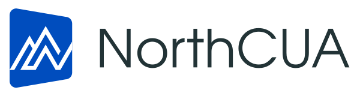
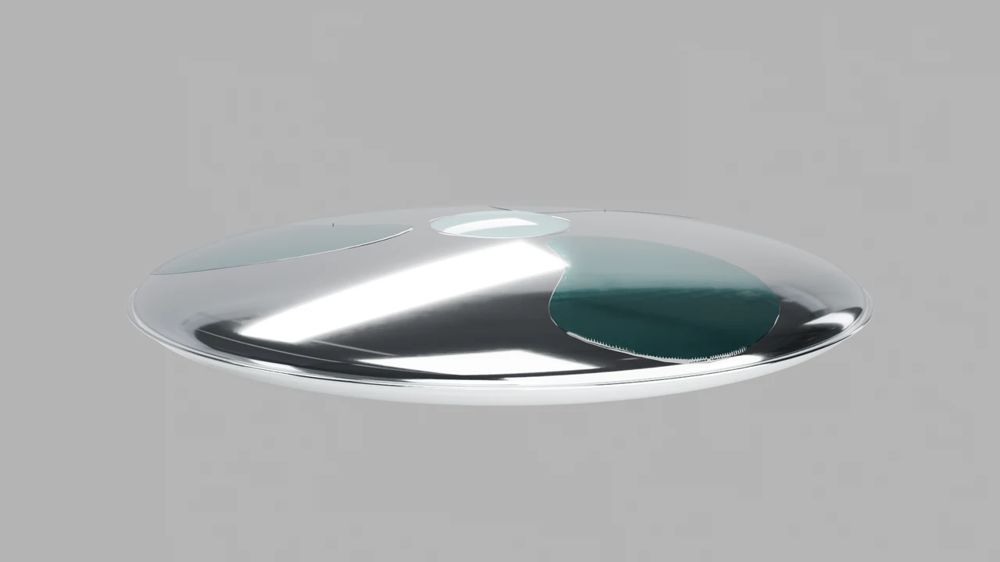
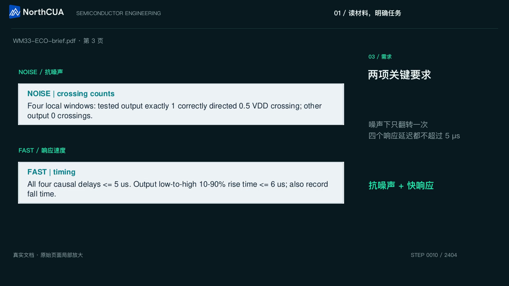
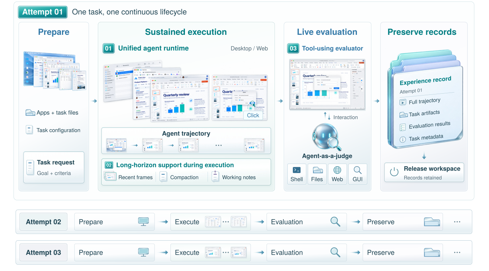

<div align="center">

<picture>
  <source media="(prefers-color-scheme: dark)" srcset="docs/assets/brand/northcua-logo-dark.svg">
  
</picture>

**Worlds in mind. Wonders at your fingertips.**

The open-source Desktop and Web agent harness behind NorthCUA.

[**Get started**](docs/first-run.md) · [**Watch the work**](#see-computer-use-in-action) · [**Technical Report**](docs/paper/main.pdf) · [**Models**](docs/models.md) · [**Documentation**](docs/README.md) · [**中文**](README.zh-CN.md)

[](https://github.com/china-qijizhifeng/NorthCUA-Harness/actions/workflows/ci.yml)
[](LICENSE)
[](pyproject.toml)

</div>

Give an agent a task. Let it work across applications, remember what matters,
check the outcome in the same workspace, and keep a record you can inspect.
**NorthCUA Harness** brings that lifecycle to local Desktop/Web tasks and
recoverable batches, built on public [NexAU](https://github.com/hzhua/nexau).

This repository releases the Harness from the [NorthCUA Technical Report](docs/paper/main.pdf).
It is model-agnostic: connect a vision model with structured tool calls, or try
our credential-free local tutorial first.

## See computer use in action

<table>
<tr>
<td width="50%">
<a href="docs/assets/demos/tidal-workflow.mp4"></a>
<br><strong>Sketch it. Model it. Make it move.</strong><br>
Inkscape → Blender · an editable design and animation.<br>
<a href="docs/assets/demos/tidal-workflow.mp4">▶ Watch the recorded workflow</a>
</td>
<td width="50%">
<a href="docs/assets/demos/wm33-smartest-workflow.mp4"></a>
<br><strong>Read the brief. Work through the details.</strong><br>
Semiconductor engineering · documents, tools and checks.<br>
<a href="docs/assets/demos/wm33-smartest-workflow.mp4">▶ Watch the recorded workflow</a>
</td>
</tr>
</table>

Recordings from the broader NorthCUA project; these are research showcases,
not reruns or checkpoint benchmarks of this release. Videos and posters are
bundled here. [Showcase details and provenance](docs/showcase.md).

## A harness for the whole task

[](docs/system-tour.md)

*Figure 4 of the current report. Mechanism illustration; executable checks are recorded separately.*

| What you need | What NorthCUA provides |
|---|---|
| **Act on Desktop and Web** | Native screenshot/mouse/keyboard tools, or browser screenshots, DOM references, forms and tabs, with shared session and step contracts. |
| **Stay on track over long tasks** | A bounded overlay/clean image window, task-preserving compaction and durable working notes, with complete traces retained outside prompt history. |
| **Verify what actually happened** | An independent evaluator can inspect artifacts and the original live workspace before cleanup; actor completion and evaluation verdict stay separate. |
| **Run many tasks reliably** | Controller/device execution, isolated attempts, bounded retries, persistent batch state, resume, outcome records and confirmed cleanup. |

[System tour](docs/system-tour.md) · [Paper ↔ code map](docs/paper-map.md) · [Architecture](docs/architecture.md)

## Quick start

Use **Python 3.12**, Git and [uv 0.13.6+](https://docs.astral.sh/uv/).
The commands below work in Bash and PowerShell:

```sh
git clone https://github.com/china-qijizhifeng/NorthCUA-Harness.git
cd NorthCUA-Harness
uv sync --locked --python 3.12 --extra local --extra device
uv run --no-sync playwright install chromium
uv run --no-sync northcua --help
```

Then choose one path:

- **Try it without an API key:** follow the [local Web tutorial](docs/first-run.md#2b-verify-locally-without-a-model-key), then the [three-task batch](docs/local-batch.md). The real browser and runtime use a deterministic local model endpoint.
- **Use your model:** copy [`.env.example`](.env.example), set the model ID and API key, and follow the [Bash/PowerShell configuration steps](docs/first-run.md#2a-use-your-model-edit-only-model-connection-settings). Keep the default endpoint or replace it with your provider's URL.
- **Let a coding agent operate it:** load the [NorthCUA operator skill](skills/northcua/SKILL.md), which covers installation, configuration, tasks, evidence, batch and recovery.

A model must accept images and structured tool calls. [Model setup](docs/models.md)
covers Chat, Responses, Anthropic and Gemini, plus the report's NorthCUA-Pro resource.
On Linux, install browser libraries with `uv run --no-sync playwright install --with-deps chromium`.
Desktop requires an interactive GUI and the platform permissions described in [installation](docs/getting-started.md).

Validate your generated configuration:

```sh
uv run --no-sync northcua config validate --app-config logs/my-config/app.example.yaml
```

Then choose **one** task surface. For Web:

```sh
uv run --no-sync northcua local web run --app-config logs/my-config/app.example.yaml --url https://example.com --query 'Report the main heading.' --max-steps 8
```

Or, on an interactive desktop:

```sh
uv run --no-sync northcua local desktop run --app-config logs/my-config/app.example.yaml --query 'Open a calculator and compute 12 * 7.' --max-steps 15
```

Desktop tools return screenshots directly. For a model that emits **0–1000 relative
coordinates**, set `desktop.coordinate_policy.input_space: normalized_1000` in
the app YAML; the Harness maps them to execution pixels. The default remains
`image_pixels`. Web point tools use CSS pixels and DOM refs stay element IDs.
[Copyable coordinate settings](docs/configuration.md#desktop-coordinates).

## Choose your workflow

| Goal | Guide |
|---|---|
| From zero to a checked result | [First run](docs/first-run.md) |
| Three local tasks, then resume | [Local batch](docs/local-batch.md) |
| Python, CLI, WebSocket or controller/device | [Execution modes](docs/running.md) |
| Context, images, notes and compaction | [Context and memory](docs/context.md) |
| Evaluation, artifacts and trace viewer | [Outcome evaluation](docs/evaluation.md) |
| Prepared OSWorld1 / OSWorld2 actor integrations | [OSWorld1](docs/osworld1-harness.md) · [OSWorld2](docs/osworld2-harness.md) |
| Extend, test or contribute | [Architecture](docs/architecture.md) · [Testing](docs/testing.md) · [Contributing](CONTRIBUTING.md) |

## Research, models and availability

The bundled **123-page report, 31 October 2026**, describes the broader NorthCUA
system and reports its model results. This repository publishes the **Desktop/Web
Harness**. Experience Flywheel, data generation, staged training and model weights
are separate research components, not hidden install requirements.

The report names the [project website and Hugging Face model page](docs/resources.md).
At the release check, the website returned 404 and the model endpoint returned 401;
we therefore provide local report/demo fallbacks and do not claim public weight
availability or a model-weight license. [Model guidance and availability](docs/models.md).

**What has been checked:** the [release verification](docs/release-0.2.0.md) records
fresh installation, regression tests, real-browser tasks, local batches, installed
wheels and independent reviews. Scripted-model integration is distinct from
hosted-model capability and full OSWorld/cloud acceptance. PyPI publication is
not required or assumed by these source-install commands.

## Contribute and cite

Bug reports and small, reproducible contributions are welcome. Start with
[CONTRIBUTING.md](CONTRIBUTING.md) and the [clean scope](docs/clean-scope.md).
For reproducible research, record your code/NexAU revisions, model settings,
task source, observation/action profile and evaluation protocol.

```bibtex
@techreport{northcua2026,
  title  = {NorthCUA Technical Report: Turbocharging Computer-Use Agents through Experience at Scale},
  author = {{NorthCUA Team}},
  year   = {2026},
  url    = {https://github.com/china-qijizhifeng/NorthCUA-Harness/blob/main/docs/paper/main.pdf}
}
```

[Citation metadata](CITATION.cff) · [Apache-2.0](LICENSE) · [Third-party notices](THIRD_PARTY_NOTICES.md) · [Security](SECURITY.md) · [Changelog](CHANGELOG.md)

## Contact

For questions about NorthCUA, research discussions or collaboration:

- [zhangchaoyun@qijizhifeng.com](mailto:zhangchaoyun@qijizhifeng.com)
- [libingxuan@qijizhifeng.com](mailto:libingxuan@qijizhifeng.com)
