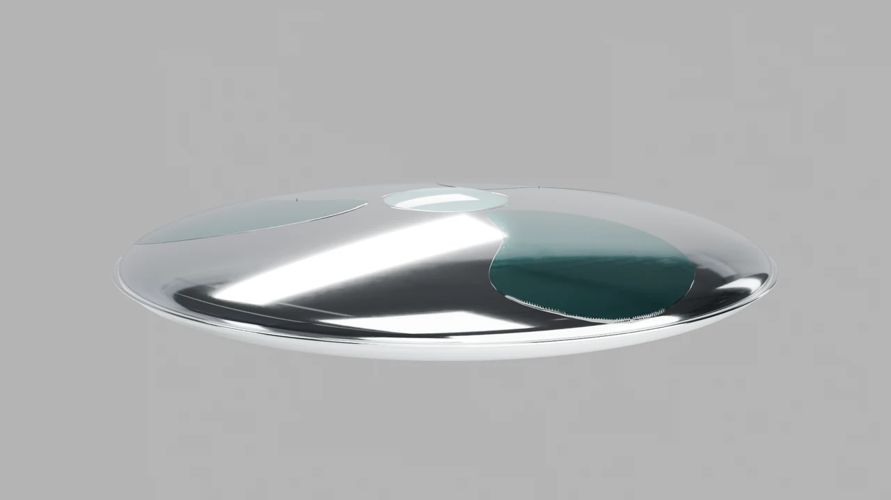
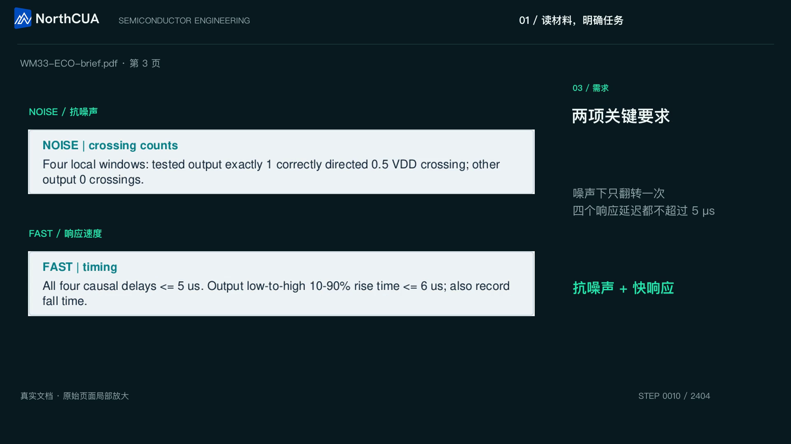
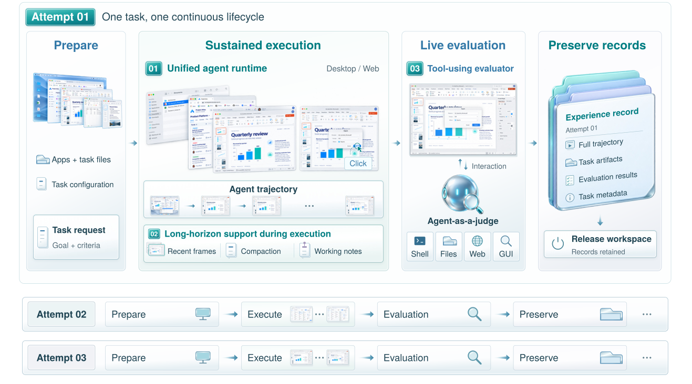

<div align="center">

<picture>
  <source media="(prefers-color-scheme: dark)" srcset="docs/assets/brand/northcua-logo-dark.svg">
  
</picture>

**心中万象，指间成形。**

面向桌面与网页智能体的开源 NorthCUA Harness

[**从零开始**](docs/first-run.md) · [**观看演示**](README.md#see-computer-use-in-action) · [**技术报告**](docs/paper/main.pdf) · [**模型接入**](docs/models.md) · [**文档**](docs/README.md) · [**English**](README.md)

Python 3.12+ · Apache-2.0 · 基于公开 [NexAU](https://github.com/hzhua/nexau)

</div>

给 Agent 一个任务，让它跨应用操作、记住关键进展、检查原工作区中的实际结果，
并留下可追溯记录。**NorthCUA Harness** 把这个完整过程连接起来：
从本地单任务，到支持隔离、重试与恢复的批量执行。

本仓库提供最新 [NorthCUA Technical Report](docs/paper/main.pdf) 中的 Desktop/Web Harness，
不绑定单个模型。可以接入支持图像和结构化工具调用的端点，也可以先用无密钥教程验证运行链路。

## 看看 Agent 能把工作推进到哪里

| 草图到模型与动画 | 半导体工程工作流 |
|---|---|
| [](docs/assets/demos/tidal-workflow.mp4) | [](docs/assets/demos/wm33-smartest-workflow.mp4) |
| [播放完整工作流](docs/assets/demos/tidal-workflow.mp4) | [播放完整工作流](docs/assets/demos/wm33-smartest-workflow.mp4) |

演示来自更大的 NorthCUA 项目，视频和预览图均随仓库提供；不代表本次发布版本重新运行的任务或模型基准。
[演示说明与来源](docs/showcase.md)。

## 不止于点击：覆盖整个任务生命周期

[](docs/system-tour.md)

*最新报告 Figure 4 的机制示意；实际执行验证单独记录。*

- **桌面与网页统一执行。** Desktop 使用截图与鼠标键盘；Web 使用截图、DOM/ref、表单与标签页。共享会话、步骤、工具契约和记录。
- **长任务持续推进。** 有界图像窗口、操作轨迹标注、任务保真压缩和持久化 note，让后续决策保留需要的信息。
- **检查实际结果。** 独立 evaluator 可以读取产物，并在清理前检查同一工作区；Agent 宣称完成与评估结论分别保存。
- **可恢复跑批。** Controller/device、隔离 attempt、持久化状态、重试、resume 与清理确认，支持从单任务扩展到批量执行。

[系统导览](docs/system-tour.md) · [论文与实现对应](docs/paper-map.md) · [架构](docs/architecture.md)

## 快速开始

需要 Git、[uv 0.13.6+](https://docs.astral.sh/uv/) 和 Python 3.12。以下命令可用于 Bash 和 PowerShell：

```sh
git clone https://github.com/beipo-ai/NorthCUA.git
cd NorthCUA
uv sync --locked --python 3.12 --extra local --extra device
uv run --no-sync playwright install chromium
uv run --no-sync northcua --help
```

然后选择入口：

- **先验证安装：** 按[无密钥 Web 教程](docs/first-run.md#2b-verify-locally-without-a-model-key)启动本地确定性模型服务，再运行[三个任务的小批次](docs/local-batch.md)。不需要远端私有环境。
- **使用自己的模型：** 复制 [`.env.example`](.env.example)，最少填写模型名、API key；按[配置教程](docs/first-run.md#2a-use-your-model-edit-only-model-connection-settings)加载，端点需要时再修改。教程区分 Bash 与 PowerShell。
- **交给 Agent 操作：** 直接加载 [NorthCUA 使用 skill](skills/northcua/SKILL.md)，覆盖安装、配置、启动、验证、跑批和恢复。

Linux 安装浏览器系统依赖可用 `uv run --no-sync playwright install --with-deps chromium`。
Desktop 需要交互桌面和相应权限；macOS 需要屏幕录制与辅助功能权限。见[安装指南](docs/getting-started.md)。

生成配置后，先校验：

```sh
uv run --no-sync northcua config validate --app-config logs/my-config/app.example.yaml
```

再选择一种任务。Web：

```sh
uv run --no-sync northcua local web run --app-config logs/my-config/app.example.yaml --url https://example.com --query 'Report the main heading.' --max-steps 8
```

或者在交互桌面上运行 Desktop：

```sh
uv run --no-sync northcua local desktop run --app-config logs/my-config/app.example.yaml --query 'Open a calculator and compute 12 * 7.' --max-steps 15
```

Desktop 只有工具直接返回截图这一条观察路径。若模型输出 **0–1000 相对坐标**，
在本次运行的 app YAML 中开启 `desktop.coordinate_policy.input_space: normalized_1000`；
默认值是 `image_pixels`。Web 点操作使用 CSS 像素，DOM/ref 是元素 ID。
[可复制的坐标配置](docs/configuration.md#desktop-coordinates)。

## 从单任务到完整工作流

| 目标 | 文档 |
|---|---|
| 从零到可检查的结果 | [First run](docs/first-run.md) |
| 三个本地任务、恢复与清理 | [Local batch](docs/local-batch.md) |
| Python、CLI、WebSocket、Controller/device | [运行方式](docs/running.md) |
| Context、图像窗口与工作记忆 | [上下文](docs/context.md) |
| 输出检查、在线评估与轨迹查看器 | [评估](docs/evaluation.md) |
| 已准备环境上的 OSWorld1 / OSWorld2 actor | [OSWorld1](docs/osworld1-harness.md) · [OSWorld2](docs/osworld2-harness.md) |
| 开发、测试与扩展 | [贡献](CONTRIBUTING.md) · [测试](docs/testing.md) |

## 研究与发布状态

仓库附带 **2026-10-31、123 页的最新技术报告**。报告包含完整 NorthCUA 系统和模型结果；
本仓库发布 Desktop/Web Harness。Experience Flywheel、数据生成、分阶段训练与模型权重是独立研究组成，
不是运行本仓库所需的隐藏依赖。

报告中的 NorthCUA-Pro Hugging Face 页在发布检查时返回 401，权重公开状态与许可证尚未确认。
[资源状态页](docs/resources.md)如实记录可用性；报告与演示均随仓库提供。
[模型指南](docs/models.md)说明端点接入与坐标配置，不暗示权重已公开或沿用代码许可证。

[发布验证记录](docs/release-0.2.0.md)区分从零安装、回归、真实浏览器、本地跑批、安装包和独立 review。
脚本模型集成测试不等于真实模型能力或完整 OSWorld／云端基准验收。
源代码安装不依赖已经存在的 PyPI 发行版。

引用请使用 [CITATION.cff](CITATION.cff)，并记录代码/NexAU revision、模型设置、任务来源与评估协议。
[Apache-2.0](LICENSE) · [第三方声明](THIRD_PARTY_NOTICES.md) · [安全](SECURITY.md) · [更新](CHANGELOG.md)

## 联系我们

项目使用、研究交流与合作，请联系：

- [zhangchaoyun@qijizhifeng.com](mailto:zhangchaoyun@qijizhifeng.com)
- [libingxuan@qijizhifeng.com](mailto:libingxuan@qijizhifeng.com)
