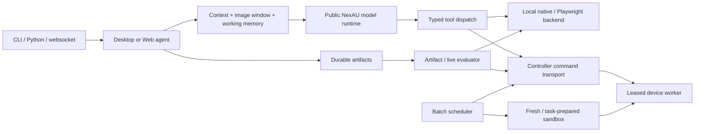

# NorthCUA Harness architecture

The NorthCUA repository currently packages the NorthCUA Harness. The following components
implement its Desktop/Web task lifecycle on public NexAU.

The protocol distribution defines task/session/command/artifact contracts. The shared
runtime distribution defines tool schemas and backend bridges. The device distribution
executes permitted commands. The root distribution owns agents, controller plugins,
context/evaluation and orchestration; its desktop bridge is an explicit device dependency.

`agentkernel` contains policy/data abstractions; `agentinfra` connects NexAU, providers,
context persistence and runtime infrastructure; `agentkit` composes reusable agent and
evaluator execution. Desktop and Web specialize observations and actions. These layers
are retained because the runnable paths and extension contracts depend on them.

NexAU adapters preserve NorthCUA's message, error, tracer and session contract
on top of the pinned public runtime. Some compatibility hooks affect agent creation/history. Removing them is a
behavioural change and requires the focused provider, lifecycle and history tests.
The old private/public migration approval framework is not part of the runtime.

A controller lease defines which worker/session may execute commands. Task cancellation
and cleanup stay distinct from terminal task decisions. The actor browser remains live
through evaluation, then closes once. Prepared sandboxes belong to a task attempt;
capacity is never recycled as hidden cross-task application state.

The retained `nexau_compat` layer has no private dependency. It defines explicit XML
formatting, request/replay normalization, error-history and persistence behavior over
public NexAU. Some internal symbols retain historical names. The old migration
administration, duplicate CLI registry and unused visual planner have been removed;
the generated AgentKit CLI and actual message projector are the maintained paths.
