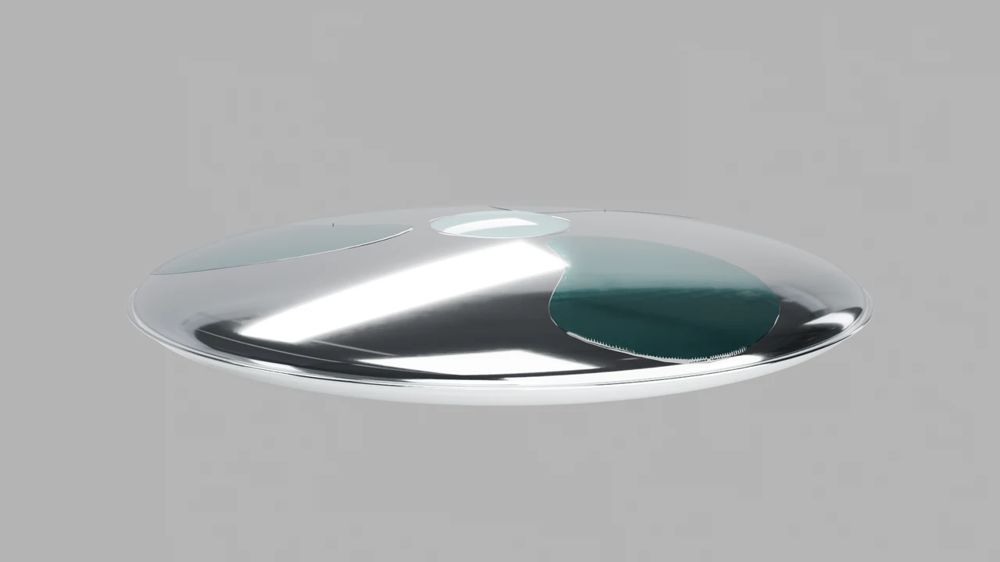
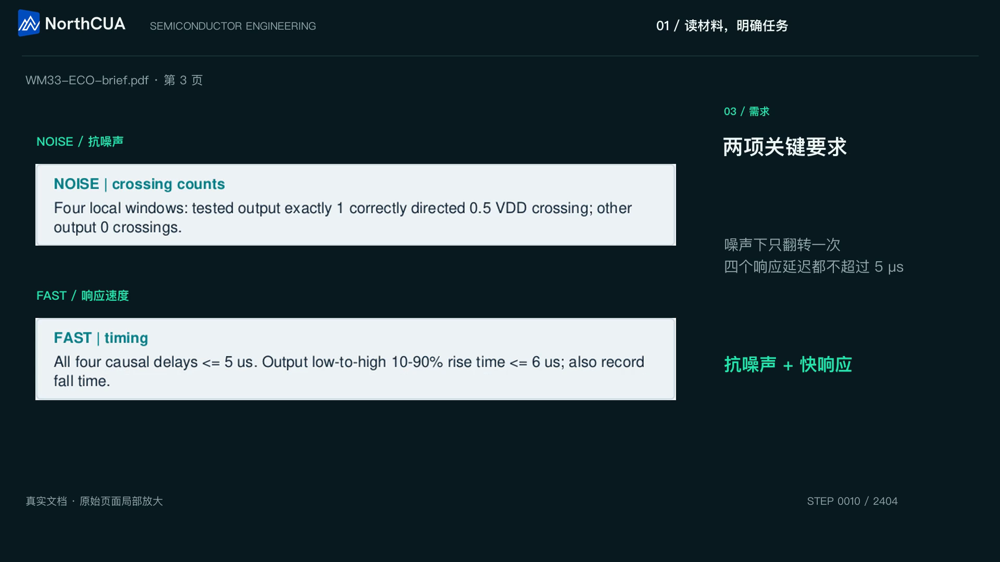

# Recorded workflows

These recordings show computer-use work from the broader NorthCUA project.
They are bundled media, not executable tutorial fixtures. The code release has
its own [reproducible first run](first-run.md), [local batch](local-batch.md) and
[verification](release-0.2.0.md).

## TIDAL-01 — Inkscape to Blender

[Play the recorded workflow](assets/demos/tidal-workflow.mp4).
A three-view sketch becomes an editable silver-and-glass craft, an opening iris
and a camera animation. The film is an edited workflow presentation; its
playback duration is not task execution time or model inference speed.
The latest report includes TIDAL-01 in its showcase appendix.

## Semiconductor engineering — WM33 / SmarTest

[Play the recorded workflow](assets/demos/wm33-smartest-workflow.mp4).
The presentation follows a prepared engineering task through its source brief,
application work and checks. Application names remain their owners' trademarks;
engineering software, licenses, PDKs and the original environment are not bundled.
The local Web tutorial is the supported credential-free way to exercise this repo.

## Attribution and evidence boundary

The maintainer supplied these previously prepared project recordings. They use
an external controller/native CUA Driver workflow outside this clean Harness
export. They are not NorthCUA checkpoint benchmark results and were not rerun
with this release. No claim is made that the proprietary environments or editable
source artifacts can be reconstructed from these MP4 files alone.

Posters and videos retain their recorded/editorial content, including historical
wordmark styling in video overlays. The current repository/documentation lockup
is extracted from the latest report; see [brand assets](assets/brand/README.md).
[Media checksums and provenance](assets/demos/manifest.json) identify the exact
supplied recordings and the unaltered 12-second poster frame. Runtime tests do
not use these videos as proof of task success.
