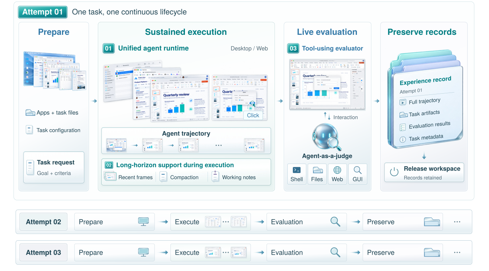
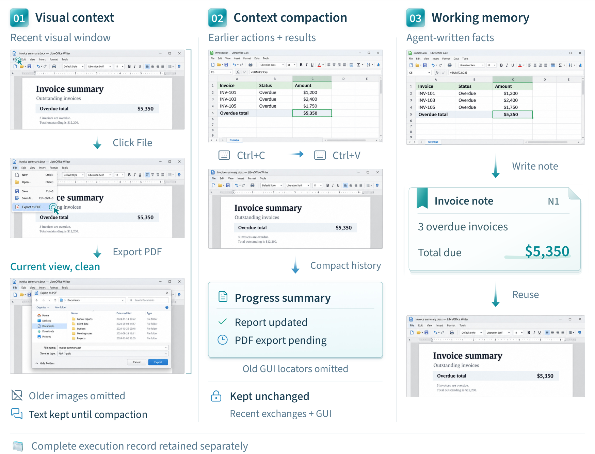
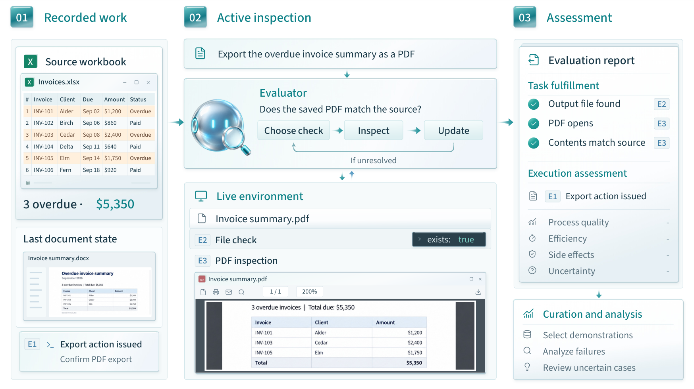

# From a task to an inspectable outcome

A computer-use task starts with a request and a software workspace. The agent needs to
connect individual operations into a workflow, and the resulting state needs to be checked
against the request. The NorthCUA Harness in NorthCUA keeps these activities associated with the same task attempt:
prepare the workspace, execute, evaluate, save evidence, then release resources.



*Research illustration from the 2026-10-31 NorthCUA Technical Report. GUI scenes and trajectories are
schematic. [Figure provenance](assets/manifest.json) identifies the source artwork.*

## One execution foundation, two interaction surfaces

Desktop observes screenshots and acts through mouse and keyboard tools. Web combines
screenshots with DOM-derived information and browser operations. Each supplies its own
observation and action implementation to a shared runtime built on public NexAU.

The runtime organizes work into **sessions**, **rounds**, and **steps**. A session identifies
an ongoing interaction and its records; a round handles one user request; a step invokes
the policy and dispatches its tool calls. This common structure lets context services,
evaluation, telemetry and task management work across both agents.

Use [local execution](getting-started.md) to begin. Move tools to a
[device worker](running.md#controller-and-worker) when the software runs on another machine.

## Keep the next decision informed

Long workflows create two kinds of information: a full record for inspection and a
bounded context for the next decision. NorthCUA retains the record while projecting a
smaller view through three complementary mechanisms.



*The report's invoice example is illustrative. It stops before PDF export is confirmed;
it is not a successful benchmark trajectory from this release.*

**Visual context** keeps the newest clean state and selected recent action overlays.
An overlay describes an operation on its pre-action screen; the clean image shows the
resulting state. Web Set-of-Mark annotations share the total image budget.

**Task-preserving compaction** summarizes eligible older exchanges while protecting the
request, current observations and unfinished interactions. A summary can retain a source
value and an outstanding export requirement after routine navigation leaves the prompt.

**Working memory** lets the agent deliberately retain a fact, constraint, correction or
checkpoint through `note` / `web_note`. A stable key replaces the active value while the
underlying event record remains durable. The active view is bounded and supplied separately
from chronological history. See [context and memory](context.md) for configuration and limits.

## Inspect the outcome while the workspace is available

An actor's terminal message establishes what it reports. Evaluation gathers evidence about
what it accomplished. NorthCUA's evaluator can retrieve selected steps and saved artifacts,
then use authorized live tools to answer questions that the trace alone cannot settle.



*Illustrative inspection sequence from the report. The clean implementation exposes
recorded evidence, authorized live probes and structured reports; this figure is not
validation of an actual exported document.*

For Web, live probes reuse the actor's browser session. A reload or replacement browser
could erase unsaved application state, so assessment runs before browser release.
Evaluator operations have their own record, and outcome judgments remain separate from
actor termination. [Evaluation and artifacts](evaluation.md) explains the lifecycle and
how to inspect or re-evaluate a run.

## Coordinate many isolated attempts

The controller assembles model requests and dispatches tools to device workers. Batch
orchestration manages creation, execution, inspection, record delivery and cleanup, with
persistent task claims and recovery state. A prepared environment belongs to one upcoming
task attempt; it is consumed once. Preparation can overlap another attempt's execution
without carrying application state across tasks.

The resulting files support debugging, evaluation and downstream research integrations.
Training and experience-production pipelines are outside this repository's release scope.
See [batch execution](batch.md) for manifests and recovery, and the
[verification matrix](verification.md#execution-matrix) for actual deployment evidence.

## Reproduce the small, real-browser check

The integration fixture serves a page and a deterministic model endpoint on localhost.
The actor records a note, clicks a button and finishes. The evaluator then inspects a
DOM marker that would disappear after a reload. Passing establishes that the actual tool,
model-provider and evaluator paths shared the intended page state.

```sh
uv sync --locked --extra local --extra device --extra dev
uv run --no-sync playwright install chromium
NORTHCUA_RUN_BROWSER_TESTS=1 uv run --no-sync pytest tests/integration/test_web_modes.py -q
```

This is a reproducible wiring check without model credentials. For actual model quality,
run a declared task set with the intended model, budgets and evaluator, and retain its
artifacts separately from these fixtures. [Testing](testing.md) lists the other checks.
